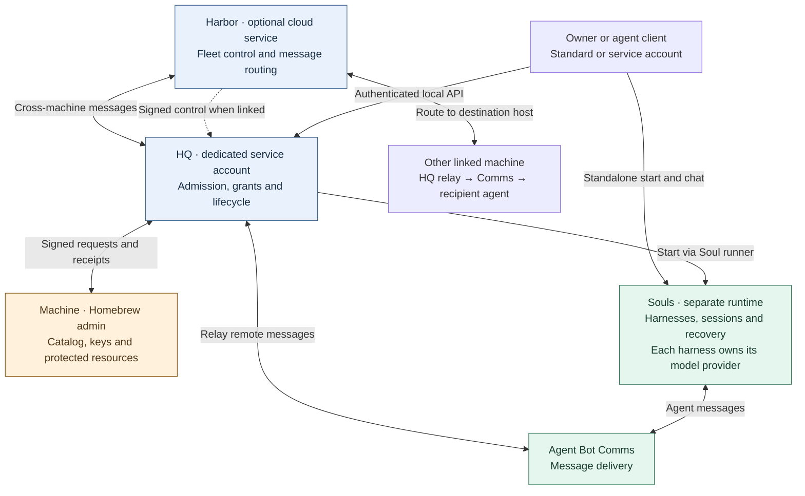

# Architecture

A user can run a Soul directly, ask local HQ to start it, or use Harbor to manage several linked hosts. In all three cases the same Souls runtime owns the harnesses and sessions. The diagram shows the intended component boundaries. The [roadmap](../10-program/roadmap.md) tracks implementation and qualification.

## Components and trust boundaries

[Mermaid source](assets/architecture.mmd) · [Editable draw.io diagram](assets/architecture.drawio) · [PNG](assets/architecture.png)

**Souls** is the meta-harness. A user opens one terminal conversation. The runtime selects and supervises harnesses, applies the Soul's policies, manages sessions and configuration, and recovers interrupted work. In a direct launch, HQ and Harbor are optional. In a managed launch, HQ starts the runner in the Soul's execution domain. Each harness owns its model-provider integration and makes model calls using its native client. Souls manages the harness session. Agent Bot Comms handles message delivery. [Soul lifecycle](lifecycle.md)

**HQ** is the local control-plane daemon in a dedicated service account. Clients in standard and other service accounts can request operations through its authenticated local API. Agents cannot access HQ's code or private state directly, and HQ cannot access ordinary users' private account data. HQ checks admission, grants and lifecycle requests. When Comms addresses an agent on another linked machine, local HQ relays the sealed message to Harbor. Harbor routes it to the destination HQ, where Comms delivers it to the agent. The solid message path and dotted signed-control path carry different records. Starting a Soul gives HQ no role in hosting its agents, managing their networking, restricting their communications or providing inference. [Cross-machine messaging](federation.md) · [Trust domains](trust-domains-and-profiles.md)

**Machine** runs as the Homebrew administrator. It manages approved installations, privileged host keys and protected resources. HQ performs the network exchange required for Machine operations and sends fixed, authenticated requests over the signed local channel. Machine verifies each request and returns a signed receipt. See the [custody boundary](../04-decisions/PDR-0091-host-privileged-custody.md) and its [standalone signing exception](../04-decisions/PDR-0093-standalone-hq-secure-enclave-signing.md).

**Harbor** is the optional cloud control plane. For machines the owner links, Harbor signs policy and lifecycle requests. HQ validates them on the host. An increase in authority requires the owner's device signature. Local-only operation is supported. [Harbor control](../04-decisions/PDR-0047-harbor-is-the-control-plane-of-a-linked-machine.md)

## How components plug into HQ

Each component ships its own executable. A package can register its HQ-facing commands and lifecycle operations through `hq-plugin-contract`. For Souls, the integration is the ability to request a start and track its lifecycle across the boundary. The [repository catalog](repository-catalog.md) identifies each component owner and the [seam catalog](seams.md) identifies each contract.

The Stage 2a qualification plan still describes an HQ-hosted communications broker. Its evidence is specific to that layout. The scope of that broker is tracked in [DRIFT-028](../00-governance/drift-register.md#drift-028-soul-traffic-and-the-hq-service-account).
