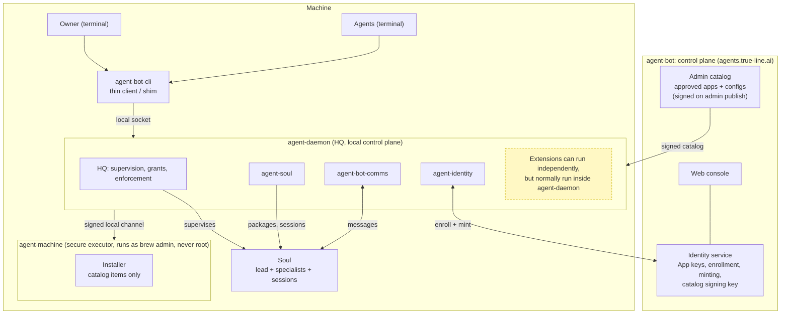

# Architecture

One network of agents in **five tiers**: you attach to one cloud node and
reach every agent through it. The same pattern repeats at each tier, and
the **Soul is the smallest unit the network addresses**.

Full narrative: [architecture source](../papers/soul-agent-system-architecture.md) ·
Vision: [north star source](../papers/agent-bot-north-star.md)

Diagram provenance: the Mermaid graph in the components section is the
current source (`assets/architecture.mmd`); `assets/architecture.drawio`
embeds the same graph, and [this PNG](assets/architecture.png) is its
rendered export. `assets/architecture-superseded-privileged-machine.mmd` is
the earlier privileged-machine sketch, kept for provenance (DRIFT-014).
The diagram uses short labels: agent-daemon is agent-bot-hq,
agent-machine is agent-bot-machine, agent-soul is the Soul runtime
(agent-bot-souls) and agent-identity is the in-Soul identity CLI.

## Two planes

- **Messaging and presence** run *up* — from the Soul to site and cloud
  hubs (relays see outer frames only).
- **Supervision** runs *down* only — from the machine manager (HQ) to
  harnesses. Relays and remote Souls hold **no control authority**: no
  launch, no cold-wake, no owner or credential authority.
- **Decision and execution are separate.** HQ alone is a complete
  deployment. On a machine the owner has linked, Harbor decides policy and
  lifecycle and HQ enforces; only HQ executes, and an action that adds
  authority carries the owner's device presence signature
  ([PDR-0047](../04-decisions/PDR-0047-harbor-is-the-control-plane-of-a-linked-machine.md)).

## Components today



## Repositories and dependency direction

Repositories follow **trust-domain and contract boundaries**, not
features, and dependencies point only toward contract repositories. HQ is
implemented in agent-bot-hq (PDR-0002); the host admin sandbox is
agent-bot-machine.

```
soul-contracts ← soul-package ← agent-bot-comms ← agent-bot-hq (HQ)
                                    ↑
agent-bot-souls (Soul runtime: contracts, package, comms client, adapters)
agent-bot-identity (contracts; identity-service API)
soul-adapters (contracts, package only)
geniusbar (HQ client only)
soul-conformance (contracts at build time, binaries at test time)
```

The [repository catalog](repository-catalog.md) is the authoritative list
of repositories, their charters and dispositions; [seams](seams.md) lists
every contract between them with its home and status.

## The enforcement point

A trusted supervisor admits runtimes; a broker mediates protected
operations **outside the agent shell's trust domain** — that pair is HQ.
agent-bot-comms routes and coordinates but **never holds keys or enforces
grants** (S1 D4). Where harness and agent shell share a
trust domain, access enforcement must come from the host — or the Soul
runs unenforced and *says so*.

## Implementation path

Strangler-style migration: nothing new before soul-contracts ships
fixtures; the agent-bot daemon keeps working at every step; its HQ half is
retired only when both implementations pass the same soul-conformance run.
Stages 0 to 4 carry exit evidence; the [roadmap](../10-program/roadmap.md)
tracks them.
